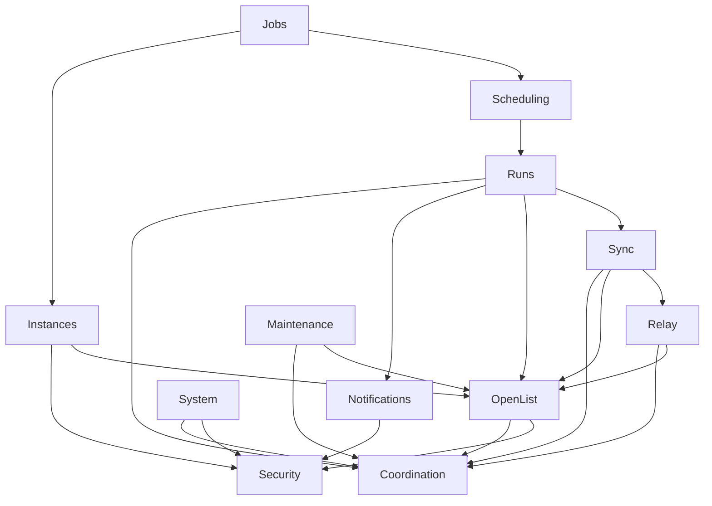

用途：规定 NestJS 模块职责、依赖方向及单进程运行视图。

范围：目标实现的应用结构与启动/停止顺序；M0 已建立基础模块；M1 加入 OpenList、Instances、Security 的实例认证状态持久化及 Coordination 的每实例 API 配额（现已删除，改为任务级扫描间隔），M2加入Jobs、Sync、Runs；M3加入Relay、路径占用、真实执行及完整Run恢复，其余模块随对应里程碑加入。

# 架构

## 模块边界

| 模块                | 职责                                                                                                                                                                              | 导入                                                         |
| ------------------- | --------------------------------------------------------------------------------------------------------------------------------------------------------------------------------- | ------------------------------------------------------------ |
| ConfigModule        | 环境解析、校验、有效默认值                                                                                                                                                        | 无；只用 Node 标准库和已有验证库                             |
| DatabaseModule      | Drizzle、迁移、事务、仓储                                                                                                                                                         | Config                                                       |
| SecurityModule      | 管理员 JWT、scrypt、AES-GCM、实例认证阻断与身份事实持久化、日志脱敏                                                                                                               | Config、Database                                             |
| CoordinationModule  | ready 标志与恢复闸门、执行位、全局 FIFO 队列状态、路径占用、隔离路径检查、按 Instance ID 与全局路径首段共享的扫描间隔、每 Job/Target 文件及 chunk 名额、每 Job relay token bucket | Config、Database                                             |
| OpenListModule      | envelope、token、路径、列表、挂载、task HTTP；调用点显式声明的目录请求在客户端内等待扫描间隔，其余请求不进入间隔队列（含浏览、连接测试、登录）                                    | Config、Security、Coordination；Instance 配置由调用者传入    |
| InstancesModule     | Instance CRUD、连接测试、目录浏览                                                                                                                                                 | Database、Security、OpenList                                 |
| RelayModule         | 源读取、spool、multipart 会话、计数、FIFO 背压、限速、取消；暴露准备句柄并等待持久化检查点                                                                                        | Config、OpenList、Coordination                               |
| SyncModule          | 扫描、纯 diff、保护检查、计划、文件协调器、依赖执行与Operation结果                                                                                                                | Database、OpenList、Relay、Coordination                      |
| NotificationsModule | 渠道管理、HMAC、有界投递                                                                                                                                                          | Config、Database、Security                                   |
| RunsModule          | 接受触发、派发、取消、启动恢复、运行视图、unknown/quarantine 管理                                                                                                                 | Database、Coordination、Sync、OpenList、Notifications        |
| SchedulingModule    | 注册/注销 cron；触发时调用 Runs 的触发服务                                                                                                                                        | Database、Runs                                               |
| JobsModule          | 配置校验、过滤、路径重叠检查；启停、归档或修改 cron 时通知 Scheduling                                                                                                             | Database、Instances、Scheduling                              |
| MaintenanceModule   | server_copy 远程任务记录清理、历史清理                                                                                                                                            | Database、OpenList、Coordination                             |
| SystemModule        | health/info、导入导出                                                                                                                                                             | Config、Database、Security、Coordination；不直接操作远程文件 |

依赖规则：

- 依赖图无环，不使用 forwardRef，也没有 AppModule 级的应用协调器。AppModule 只负责导入各模块。
- CoordinationModule 是叶子模块，只依赖 Config 和 Database（读取隔离事实）。跨 Job 的 Run、启动恢复和维护任务都从它取得执行位、路径占用和配额，因此共享同一套互斥与限额；health 读取的 ready 标志也由它持有。
- 本地不设 Instance 级 API 并发或速率配额。扫描间隔只在 OpenList 客户端内按单个 HTTP 请求等待，由调用点显式声明，不从调用上下文推断；浏览、连接测试、登录和维护请求不进入扫描间隔队列。relay 的文件读取、chunk 与 complete 等待由 Job/Target 文件配额和 chunkConcurrency 保护。server-copy 文件位由提交 copy task 的 Sync 取得。
- RunsModule 拥有 Run 的接受、派发、取消和启动恢复。它通过 Database 仓储读取 Job/Instance 配置并固定快照，不导入 Jobs 或 Instances，从而避免 Jobs → Scheduling → Runs → Jobs 的循环。
- SchedulingModule 只注册 cron，单向调用 Runs 的触发服务；手动触发由 Runs 自己的 controller 接收。
- Run 终态事务写入 delivery 行，提交后 Runs 调用 Notifications 的投递服务；Notifications 不依赖 Runs。

M1 的 `InstanceAuthState` 位于 Security，直接使用 Database 持久化认证事实；OpenListAuth 对所有调用方统一执行阻断检查、单次登录和身份核对。实例连接配置仍由调用方提供，OpenList 不导入 Instances 或 Database。凭据更新/归档后旧在途响应不能覆盖新配置；比较使用已有地址、认证方式、用户名和密文字段，不增加指纹、版本列或持久化锁。

AppModule 仅导入顶层消费模块（当前按 Jobs、Runs、Maintenance、Instances、System 排列），Instances 先导入 OpenList，再导入共享 Security/Database。Nest 12 的共享依赖拓扑重挂接会受首次遍历顺序影响；从最深消费链开始装配，确保 Config → Database → Security 的初始化顺序。生产初始化路径、完整 API e2e 与编译产物重启测试覆盖这一顺序，不增加根模块协调器。

Jobs导入Scheduling并在事务提交后更新动态cron；Maintenance导入Database/OpenList/Coordination并串行运行小时task维护及每日历史清理。Runs尚不导入M7 Notifications。Sync导入Relay，文件协调器拥有删除前准备、结果分类与持久化。Relay不反向导入Sync/Runs，通过具体的submitting、session、EOF检查点等待事务提交。关闭信号区分数据工作停止与有界控制请求清理。

纯 planner/filter 函数不依赖 Nest、HTTP、数据库；仓储只提供数据访问，不承载同步业务决策。使用具体 service 即可，不为了单一实现引入工厂/策略接口。

## 依赖方向

箭头表示“导入”。为简洁起见，图中省略各模块对 Config 和 Database 的导入。

## 启动和停止

1. Config 校验环境并准备数据目录与 spool 目录（权限见[安全](security.md)）；Database 打开 SQLite，设置 foreign_keys、WAL、FULL、busy_timeout，在迁移事务外临时关闭foreign_keys，再应用随发行版附带的前向迁移；重建迁移在事务内断言外键完整性，失败回滚。完成后恢复并确认foreign_keys=ON并再次检查完整性。此时不初始化管理员、不写入 ENC、不开放 HTTP 或后台工作；迁移不得自行生成密钥或重加密业务数据。
2. Security 按数据库中是否已有 ENC 读取或生成密钥（规则见[配置](../reference/configuration.md)），逐批试解密已有密文。缺密钥或密钥不匹配直接失败，不写入任何新密文；校验通过后才初始化管理员及其他秘密。
3. Runs 执行启动恢复：先在 Coordination 中重建全部未决task额度和路径责任（非终态 Run 的路径占用，以及从数据库读取的 unknown 隔离），再按[启动恢复](scheduling-recovery.md#启动恢复)处理旧 Run。queued 重新入队；scanning/planned 转为 interrupted；executing/cancelling/recovering 转为 recovering，后台有界跟踪已知 task，最终 interrupted（stopReason=PROCESS_RESTART）。recovery_deadline_at 只在首次进入 recovering 时写入，后续重启沿用。
4. 启动 HTTP；迁移完成且未决责任重建完毕后，Coordination 置 ready=true。恢复中的Run继续占用路径与已知非终态task额度，但不占新Run执行位。任务额度可恢复到高于当前容量，控制请求不等待task位。
5. Coordination 在第 3 步的责任重建完成前，不为新 Run 或维护发放执行位与路径占用。重建完成后，Runs 开始派发 queued Run，Scheduling 注册 enabled Job 的 cron，Maintenance 启动定时器。

第 1、2 步由各模块的初始化钩子按导入依赖顺序执行，生产入口与 e2e 测试共用同一初始化路径。任一步失败即关闭已打开的资源并以非零码退出；日志只记录错误码、异常名与系统/SQLite 错误码，不记录可能含路径或 SQL 参数的原始 message。

SIGTERM（计划内停止）不写任何 Run 终态，完整规则见[优雅停止](scheduling-recovery.md#优雅停止)：

1. Coordination 置 ready=false；Scheduling 停止 cron，手动触发返回 503 NOT_READY；Runs 停止派发和新的远程提交；Maintenance 停止。
2. Abort 本地扫描和下载；已记录 session 的 relay 在宽限内尝试 multipart abort，结果按 [relay 结果分类](relay.md#结果分类)记录，通常为 unknown 并隔离；未提交create的pending保持原状，下次启动统一skipped PLAN_INTERRUPTED。
3. 持久化已经收到的响应和任务状态。不对已知 OpenList task 发送 cancel，也不 delete 远程任务。
4. 在 shutdownGrace 内完成上述持久化后，关闭连接池和数据库。宽限内仍未返回的请求不在关闭期间改写，下次启动按第 3 步的正常恢复处理（例如 submitting 且无可靠响应的 Operation 记 unknown）。

数据库损坏、迁移错误、密钥错误不可降级为无持久化服务。单实例认证失败只影响使用该实例的操作，不使整个进程退出。

## 运行视图

用户/API → queued Run（固定配置）→ 执行位/路径占用 → scanning → planned → executing → 终态 → 通知。
扫描计划分批提交，全部计划结束前无远程文件写入；执行器分页取 ready Operation，不把全计划读入内存。
每个替换是 delete 与 create 的依赖链；mkdir 先于子路径 create。mirror extras 在该 target 的创建阶段成功后执行。
运行时的路径占用、semaphore 和 token bucket 都在单进程内；可恢复事实来自 Run/Operation，禁止再建持久化锁系统。

## 状态和资源归属

SQLite 存自身配置、运行及操作记录，不存跨运行文件索引。目录内容只在当前扫描中短时存在；扫描错误及受保护前缀属于 Run 诊断数据。
扫描间隔归 Job/Target（按 Instance+全局路径首段跨任务共享开始时间），relay/server-copy 文件配额归 Job/Target，relay 限速归 Job，path quarantine 归未知 Operation，spool 归当前进程（重启清空）。
跨 Job 的 Run 和维护任务都通过 CoordinationModule 取得资源；详情见[调度与恢复](scheduling-recovery.md)。

## 工程基线

镜像固定 Node 22.23.3（node:22.23.3-bookworm-slim，与本地开发和测试版本一致），本地开发最低 Node 22.22.3；NestJS 12、ESM/NodeNext、TypeScript 6、pnpm。相对 TS import 写 .js；DTO 保留运行时 class 类型。依赖选择与版本固定见[约定](../development/conventions.md)。
JSON ConsoleLogger 已满足 MVP，禁止默认引入 Redis、BullMQ、Passport、Pino 或第二套 schema 库。
