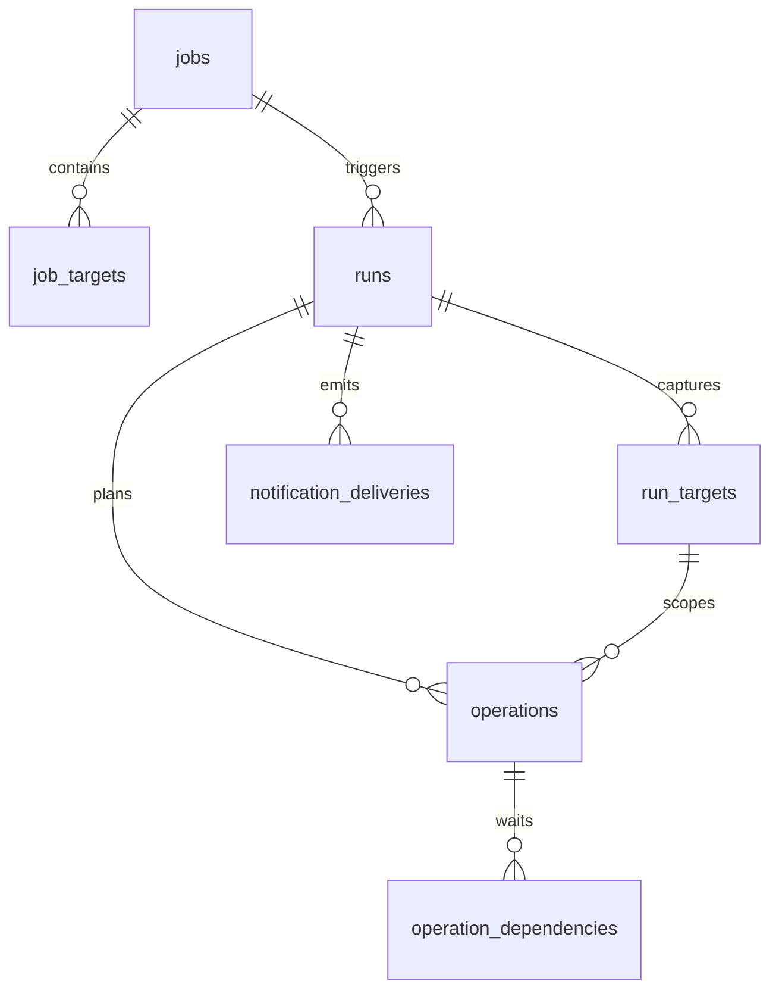

用途：定义 SQLite/Drizzle 的公共类型、约束、事务和表关系。

范围：仅本服务状态，不存本地文件索引；配置表与执行表分别在相邻文档列全。

# 数据模型总则

## SQL 类型约定

| 记号 | SQLite/Drizzle                  | 约束                                                        |
| ---- | ------------------------------- | ----------------------------------------------------------- |
| ID   | TEXT / text                     | 应用生成 UUIDv4；PRIMARY KEY 非空                           |
| STR  | TEXT / text                     | 非空；长度/API规则在应用层验证                              |
| INT  | INTEGER / integer               | JS安全整数；非负，特定字段另注明                            |
| BOOL | INTEGER / integer(mode:boolean) | CHECK(value IN (0,1))                                       |
| TS   | INTEGER / integer               | UTC Unix毫秒，非负；API输出RFC3339 UTC字符串                |
| JSON | TEXT / text(mode:json)          | CHECK(json_valid(value))，写入前DTO验证                     |
| ENC  | TEXT / text                     | [加密封装](security.md)，从不返回API                        |
| ENUM | TEXT / text enum                | SQL CHECK IN，值仅引用[状态机](state-machines.md)和字段定义 |

下表所有字段除标注 `?` 外均 NOT NULL；未列默认值的字段必须显式提供。created_at、updated_at 默认由应用写当前TS；updated_at 每次变更更新。不使用数据库本地时区。
大小 INT 最大 9007199254740991，未知大小存 NULL，API size=null；禁止以 -1 参与相等判断或上传。聚合超过安全整数则运行失败 RESOURCE_LIMIT，不截断或舍入。
所有 FK 开启 foreign_keys。除明确 CASCADE 的纯历史子表外用 ON DELETE RESTRICT。所有配置删除为逻辑归档，实际清理由保留规则限定。

## 表清单

配置表：[admins、instances、jobs、job_targets、notification_channels、job_notification_channels](configuration-tables.md)。
执行表：[runs、run_targets、operations、operation_dependencies、scan_issues、notification_deliveries](execution-tables.md)。

## 运行配置固定

run_config_json 持久化规范化后的 Job 公共字段、Target完整列表、目标稳定UUID、Instance id/baseUrl/authMode/username/accountBasePath、全部有效默认值、通知channel id、snapshotVersion=1。
不存解密secret、JWT、sign、storage.addition、下载URL、Webhook URL。source/target路径密码放 runs.secret_snapshot_enc，内容仅为按endpoint id键控的密码；没有路径密码时为NULL。

run_config_json的精确形状为{snapshotVersion:1,job:JobView,instances:Record<instanceId,InstanceSnapshot>,settings:ExecutionSettings}。JobView为当时的完整公共形状，每个targets[]对象包含必填createMode；retryCount在迁移中对历史Run补为null，settings.retryMaxAttempts仍保留接受Run时的有效尝试次数。Job本身不含Target级createMode；InstanceSnapshot={id,name,baseUrl,authMode,username:string|null,accountUsername:string|null,accountBasePath,accountRole,accountPermissions,limits,downloadMode}，不含authState、error或secret。run_targets.target_snapshot_json={target:JobView.targets中对应对象,instance:对应InstanceSnapshot}。
ExecutionSettings使用[配置](../reference/configuration.md)定义的映射。secret_snapshot_enc解密形状为{sourcePassword:string|null,targetPasswords:Record<targetId,string|null>}，无任何路径密码时整个字段NULL。
Instance 的连接配置在[未决责任](#responsibility)引用它时禁止修改地址/账号/删除；允许原地址同账号更新token/password恢复认证。账号是否相同以 /api/me 返回的 username 与 base_path 为准，见[OpenList集成](openlist-integration.md#认证与实例身份)。
Instance.limits/downloadMode在被非终态Run引用时也禁止修改；name允许修改但不回写旧snapshot。全局执行位/队列容量为进程级配置，不是每个Run各自建立一套配额。
Job 编辑在存在非终态Run时409；无活动Run时可编辑，但旧target逻辑归档，稳定id不复用。old runs永远读自己的JSON，不联表读取新Job配置决定远程操作。
获取运行配置和插入queued在同一短事务；启动时不重新套用新的默认值。

## 事务边界

1. 触发事务：检查Job状态、非终态唯一约束、队列上限，插入Run+run_targets。
2. 规划事务：按配置批量插入operations（含按计划顺序递增的seq）/dependencies/issues；最后事务将Run改planned并记录scanCompletedAt。dry-run不创建任何远程责任。
3. 提交事务：pending→submitting，写attemptNo/开始时间；事务提交成功后才发网络请求。relay收到有效init响应后先写upload_id等session信息，再发送chunk；源EOF验证后先写source_stream_completed_at，再发布最后一个chunk。
4. 响应事务：保存task id或结果；unknown同时写unknownSince/unknownUntil及受影响路径。
5. delete成功事务：标记delete成功、开放依赖create。
6. Run终态事务：聚合计数、写结束时间、创建本次best-effort投递记录。通知发送在事务之外。

远程调用不放在SQL事务中。远程提交与SQLite无法原子提交；submitting崩溃窗口是设计事实，不使用自造幂等键宣称解决。

## 持久性与清理

运行期连接固定设置 journal_mode=WAL、synchronous=FULL、foreign_keys=ON、busy_timeout=5000ms。启动迁移在Drizzle事务外临时关闭foreign_keys，重建表的迁移在事务内用CHECK断言foreign_key_check无违规，否则连同数据和迁移记录一起回滚。迁移完成后恢复并确认foreign_keys=ON，再检查外键完整性；失败即关闭连接并退出，不能开放业务工作。只有一个写连接，短批事务，不在进度每个chunk上写入。
历史查询用(run_id,seq)、(status,created_at,id)索引分页；客户端不得拉取全部operations作进度聚合。
具体清理算法见 [维护与历史保留](retention.md)。运行配置JSON不是跨运行目录快照，不用于代替下一轮扫描。

## 未决责任谓词

Instance 编辑/归档、Job 归档后的引用保留、历史清理都使用同一个“未决责任”判断。一条记录在满足以下任一条件时承担责任：

| 条件             | 说明                                                                                      |
| ---------------- | ----------------------------------------------------------------------------------------- |
| 非终态 Run       | status 不在终态集合                                                                       |
| 未解决的 unknown | Operation.status=unknown 且 resolution_kind 为空（含 REMOTE_TASK_CHANGED 新建的 unknown） |
| 待清理远程任务   | remote_cleanup_pending=1                                                                  |

历史清理在此基础上额外要求整条引用闭包（后续 Run/Operation 的 retry_of、resolved_by 等引用）全部超期且无责任，见 [维护与历史保留](retention.md#sqlite历史)。

Run路径密码仅服务当前Run扫描、执行和恢复；在终态事务清除，包括interrupted。后续重新观察由新Run使用自己的快照，不回借旧Run密码。M3沿用现有schema，不建立spool表、额外checkpoint列或持久化路径锁。

M4–M6：Run.trigger=cron时scheduled_at为注册记住的理论发生时刻。task本地终态与remote_cleanup_pending同事务写入；维护的安全/housekeeping分类不持久化。abandon只结束unknown责任，flag仍由维护按当前事实处理。历史资格按整组判断，物理删除按有界事务提交，过期历史可暂时不完整。新增expiry、反向引用及责任稀疏索引用于闭包及FK检查，不增加持久锁或cancel字段。

逐目标创建方式的前向迁移保留已应用SQL及元数据：所有Target行（含已移出成员集合或父Job已归档的行）继承其Job当前值；Run的两份Target快照均取该Run自己的历史值，保留数组顺序和其它配置，然后移除历史Job层字段。非规范快照中止迁移，不补默认值。终态历史清理可能已移除run_targets而尚未删除Run；迁移仍转换其完整Job快照，并只转换剩余子记录，不重建已清理记录。snapshotVersion仍为1，运行期只读取迁移后的单一形状。
