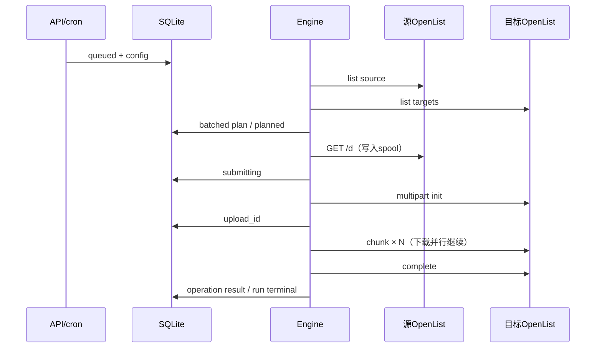

用途：用事件顺序明确正常、预览、失败、中断及隔离释放的因果关系。

范围：设计时序，不代表所有远程步骤具有原子性；状态名取自[状态机](state-machines.md)。

# 时序

## 正常运行

1. 手动REST请求或cron回调调用RunsModule的触发服务；同一事务建立queued Run、固定配置，获取Job名额。
2. 从CoordinationModule得到全局执行位及路径占用（dry-run全部端点read；实跑source=read、targets=write），进入scanning。先列source根（失败则Run failed）和各Target根：Target根缺失时实跑先计划一个prepare mkdir，无法判定时该Target记TARGET_ROOT_UNAVAILABLE（规则见[同步引擎](sync-engine.md)）。随后逐目录source→各Target，批量存计划。
3. scanCompletedAt与planned同事务落库；计算保护与预算。
4. executing；父mkdir成功后按各Target快照的[创建方式](sync-engine.md#创建方式)创建文件：relay走分片流水线，server_copy为无task成功或task终态成功；替换按下节链执行。
5. 每Target创建阶段成功且无阻断类异常，才执行mirror extras删除；仅当mirror且syncEmptyDirs=true时，再自底向上移除Target独有的空目录。
6. 聚合Run终态，同一事务为订阅该事件的已启用channel创建delivery；释放运行资源，通知独立投递。server_copy的远程终态task持久化后再清理。

server_copy时从GET到complete的各步换成一次`/api/fs/copy`，返回成功或task id，有task则逐id查询info直至终态，终态持久化后delete_some。

## Dry-run

同正常运行完成scan/plan/safety，随后直接succeeded或partial（source根失败为failed）。Operation.pending表示计划动作，实际成功计数仍0；不执行mkdir/delete/create，不下载，不发自动Webhook。Target根缺失时展示全部create并报告TARGET_ROOT_WILL_BE_CREATED。
API查询展示预算、冲突、保护原因。下一次实跑是新Run，不执行这个旧计划。认证和目录refresh可能改变OpenList缓存，这是允许的读操作副作用。

## 替换后创建失败

1. relay先打开源GET并写入首块；源不可用则create failed，旧文件不动。server_copy没有这一步。
2. delete前用refresh=true重新读取目标父目录，旧文件类型/大小与计划匹配，并通过所有删除保护。
3. delete pending→submitting，提交remove；明确成功后按[替换链](sync-engine.md#替换链)确认原名称消失，delete succeeded，开放create。
4. create submitting/running，目标拒绝或传输失败；保留failed或unknown，不回滚。
5. 目标此时缺少该文件；Target extras禁止。delete已成功，所以Run partial；取消或重启时分别为cancelled/interrupted。
6. 后续非dry-run Run看到目标缺失，按普通计划重新create；unknown的路径先等隔离到期并重新观察。原failed/unknown不改写。

本服务不保存被删除的旧文件。

## 用户取消

cancel API持久化cancelRequestedAt → Run cancelling → 停止新派发 → pending cancelled → 中止本地下载并对已记录的multipart session发abort → cancel已知tid → 轮询至终态/宽限。
已成功动作保留；无终止证据的已提交动作unknown+隔离；Run cancelled（stopReason=USER_CANCEL）。再次cancel返回现状，不删除运行中的远程任务来伪造停止。
queued Run直接cancelled。recovering Run只记录cancelRequestedAt并对未终态的已知tid每进程最多尝试cancel一次，崩溃后可重复，终态仍为interrupted（见[取消与超时](scheduling-recovery.md#取消与超时)）。

## 提交响应丢失

SQLite submitting已提交 → OpenList可能接受 → 网络响应丢失 → Operation unknown，保存受影响路径和截止时间 → 依赖create skipped（DEPENDENCY_FAILED）→ Run按聚合规则partial或failed。
不通过远程task.name猜tid，不用path+size接管multipart session，不立刻重发。其他无冲突路径仍可工作。下一Run在active隔离内跳过该路径，到期后走重新观察。
multipart的init一执行就启动驱动写入，所以init响应丢失同样走本序列；complete成功后session会立即移除，complete响应丢失时查不到session也走本序列。
以下情况不走这个序列：

- 明确收到code200且没有task：mkdir、server_copy记succeeded；delete进入刷新确认，不能直接开放依赖create。
- 明确的执行前拒绝（400、403、405、认证阻断）：failed。multipart的chunk/complete按[relay结果分类](relay.md#结果分类)判定。
- OpenList返回JSON 500：OpenList已处理完请求，服务用refresh=true做一次有界观察。效果已出现→succeeded（OBSERVED_AFTER_ERROR）；原状未变→failed，可在预算内重试；无法判定→unknown，之后同本序列。

分类见[OperationStatus](state-machines.md#operation-status)。

## OpenList中途重启

server_copy已知task id → info返回JSON401（password模式：OpenList重启清空了JWT有效缓存）→ 单次重新登录并重放 → info返回JSON404（task not found）→ unknown并隔离，记录原tid。静态token不受OpenList重启影响，直接看到404。
未启用任务持久化时不能从404判断操作未执行；OpenList对其他用户的task同样返回404，因此账号切换导致task不可见也同样不安全。原Run不盲目提交另一个task。
若开启持久化且task仍存在，继续跟踪其状态，不根据“重启”强制失败。
relay进行中OpenList重启：multipart session只在内存中，重启后消失；chunk或status返回404且没有完成证据→unknown并隔离。

## 本服务重启

queued保留排队期限；scanning/planned interrupted；executing/cancelling/recovering进入recovering：recovery_deadline_at仅在首次进入recovering时写入，之后的重启沿用；同一事务把剩余pending标skipped（PLAN_INTERRUPTED）。重建全部未决路径责任后清空spool，再开放新运行。
恢复只跟踪已知task，对无tid、等待确认的delete做refresh=true确认读，对已记录upload_id的relay查status并尝试abort；期限内收尾，期限外unknown；旧pending不提交，旧multipart session不继续，Run最终interrupted（PROCESS_RESTART）。manual-only Job等待人工触发。
计划内停止（SIGTERM）中止本地扫描与下载、在宽限内尝试abort已记录的multipart session，并持久化已收到的结果；不cancel已知OpenList task、不写Run终态，下次启动走同一序列（见[优雅停止](scheduling-recovery.md#优雅停止)）。
abort成功或session消失都不是远端写入终止证据。

## 隔离到期与重新观察

unknownUntil到期，或管理员release写入释放时间 → 下一个要写相关路径的非dry-run Run先对全部受影响父目录refresh=true → 若失败/疑似不完整则仍不写 → 若成功，记录已重新观察并按当前源目标状态规划。管理员abandon直接结束该记录，不再要求这次刷新。
符合条件则记录独立observed resolution；缺失create；大小变化按删除链；冲突保护。所有新操作仍受阈值和完整性约束。
到期、提前release或abandon不修改旧unknown。
旧请求仍可能在这个序列之后写入；本产品接受此风险（见[ADR 0004](../adr/0004-quarantine-expiry.md)），不宣称刷新是远程操作屏障。完整规则见[Unknown隔离](scheduling-recovery.md#unknown隔离)。

M3的零字节put若返回意外task：写unknown及UPSTREAM_PROTOCOL_ERROR并隔离，不保存tid或启动上传task跟踪。init session落库后若frontier实际payload无法在当前独占spool预算中容纳：有界abort后failed SPOOL_FULL，不在容量条件未变时反复init。
